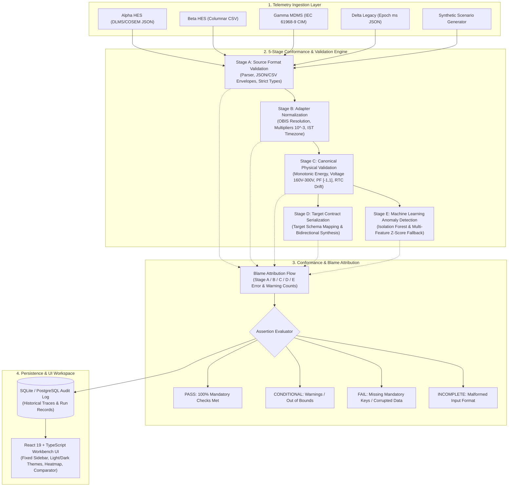
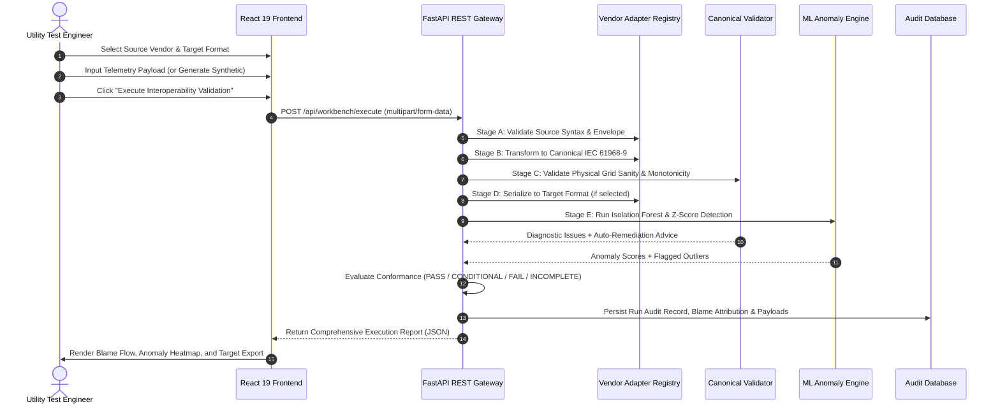

# VIDYUTSETU (विद्युतसेतु)
### Enterprise AMI Data Exchange Interoperability & Conformance Workbench

[](tests/)
[](docs/)
[](frontend/)
[](backend/)
[](LICENSE)

**VidyutSetu** is an enterprise-grade, software-based **Advanced Metering Infrastructure (AMI) Data Exchange Interoperability Testing Workbench**. Designed for power distribution companies (DISCOMs undergoing RDSS rollouts, European DSOs, and municipal utilities), smart meter manufacturers, Head-End System (HES) providers, and Meter Data Management System (MDMS) vendors.

It enables utilities and integrators to validate, benchmark, normalize, and cross-transform telemetry payloads and control messages at the data-exchange layer without requiring physical hardware benches or costly field deployments.

---

## 🏛️ System Architecture

VidyutSetu implements a **5-stage deterministic conformance pipeline** coupled with machine learning telemetry anomaly detection and automated blame attribution.



---

## ⚡ Core Capabilities

- **Standards-Compliant Canonical Data Model**:
  - Full adherence to **IEC 61968-9 Ed. 2** (Interfaces for meter reading and control).
  - Indian Standard Companion Specification **IS 15959 (Parts 1–3)** for static direct connected and transformer-operated smart meters under RDSS.
  - Device Language Message Specification / Companion Specification for Energy Metering (**DLMS/COSEM / IEC 62056**).

- **Multi-Vendor HES/MDMS Bidirectional Adapters**:
  - `Alpha HES`: DLMS/COSEM OBIS register dictionary with scaler powers of 10 (`1.0.1.8.0.255`, `1.0.12.7.0.255`, etc.).
  - `Beta HES`: Columnar CSV format with Indian Standard Time (`DD-MM-YYYY HH:mm:ss`, IST UTC+05:30) and kW/kWh telemetry.
  - `Gamma MDMS`: IEC 61968-9 CIM JSON structure with nested `EndDevice`, `IntervalBlocks`, and `ReadingQuality`.
  - `Delta Legacy`: Legacy industrial telemetry format utilizing integer milli-units (`act_wh`, `volt_mv`, `curr_ma`).

- **Deterministic 5-Stage Conformance Grading**:
  - Replaces arbitrary black-box scores with **deterministic assertion evaluation**:
    - **`PASS`**: All mandatory schema, physical grid limits, and register rules satisfied.
    - **`CONDITIONAL`**: Mandatory rules satisfied with non-critical warnings (e.g. voltage excursion outside nominal limits).
    - **`FAIL`**: Fundamental contract breach (missing meter ID, non-monotonic energy register drop, negative active consumption).
    - **`INCOMPLETE`**: Parser failure or zero valid interval records.

- **Stage-by-Stage Blame Attribution Flow**:
  - Isolates discrepancies to the exact component: **Stage A (Source Schema)**, **Stage B (Adapter Multiplier)**, **Stage C (Canonical Sanity)**, **Stage D (Target Contract)**, or **Stage E (ML Anomaly)**.

- **Stage E Machine Learning Telemetry Anomaly Detection**:
  - Unsupervised **Isolation Forest** coupled with multi-feature **Z-score fallback** per meter.
  - Detects diurnal consumption anomalies, reverse current injections, neutral disturbances, and power factor inversions.

- **Run-to-Run Regression & Improvement Comparator**:
  - Compare any Baseline Run against a Candidate Run (`/api/test-runs/compare`).
  - Automated detection of resolved issues, newly introduced contract regressions, and persistent defects.

- **Enterprise React 19 UI Workspace**:
  - Fixed left-hand navigation sidebar with live system heartbeat indicator.
  - Native **Light Mode & Dark Mode** with instant theme toggle.
  - Interactive ML Anomaly Heatmap with per-cell tooltips and flagged reading drilldowns.
  - Live two-way multiplier matrix and side-by-side contract diffing tool.

---

## 🔄 End-to-End Execution Flow



---

## 📊 Cross-Vendor Register Mapping Matrix

| Canonical Attribute | Physical Unit | DLMS / IS 15959 OBIS | Alpha HES (DLMS) | Beta HES (CSV) | Gamma MDMS (CIM) | Delta Legacy |
| :--- | :--- | :--- | :--- | :--- | :--- | :--- |
| **`active_energy_import_kwh`** | kWh (Cumulative) | `1.0.1.8.0.255` | `registers["1.0.1.8.0.255"] * 10^-3` | `KWH_IMP` | `MeterReadings[].IntervalReading.value` | `act_wh * 0.001` |
| **`active_energy_export_kwh`** | kWh (Net Metering) | `1.0.2.8.0.255` | `registers["1.0.2.8.0.255"] * 10^-3` | `KWH_EXP` | `ActiveEnergy.Export` | `exp_wh * 0.001` |
| **`reactive_energy_lag_kvarh`**| kVarh (Inductive) | `1.0.5.8.0.255` | `registers["1.0.5.8.0.255"] * 10^-3` | `KVARH_LAG` | `ReactiveEnergy.Lag` | `kvarh_lag` |
| **`voltage_v`** | Volts RMS (Phase L1) | `1.0.12.7.0.255` | `registers["1.0.12.7.0.255"] * 10^-1` | `VRMS` | `Voltage.RMS.V` | `volt_mv * 0.001` |
| **`current_a`** | Amperes RMS | `1.0.11.7.0.255` | `registers["1.0.11.7.0.255"] * 10^-2` | `IRMS` | `Current.RMS.A` | `curr_ma * 0.001` |
| **`power_factor`** | Dimensionless `[-1.0, 1.0]`| `1.0.13.7.0.255` | `registers["1.0.13.7.0.255"] * 10^-3` | `PF` | `PowerFactor.ThreePhase` | `pf_hundredths * 0.01` |
| **`frequency_hz`** | Hertz (45 – 55 Hz) | `1.0.14.7.0.255` | `registers["1.0.14.7.0.255"] * 10^-2` | `FREQ` | `Frequency.Grid` | `freq_hz` |

---

## 🚀 Quickstart Guide

### Prerequisites
- **Python**: 3.10+ (tested on Python 3.12)
- **Node.js**: v18+ (for frontend development)

### 1. Installation
```bash
# Clone repository
git clone https://github.com/PalaniappanR02/vidyutsetu.git
cd vidyutsetu

# Install backend dependencies
pip install -r requirements.txt

# (Optional) Install frontend build dependencies
npm install
```

### 2. Run the Application Locally
```bash
# Start backend and serve pre-built React production UI:
uvicorn backend.main:app --host 0.0.0.0 --port 8000 --reload

# Or use the convenience script:
chmod +x run.sh
./run.sh
```
Open **`http://localhost:8000`** in your browser.

### 3. Frontend Development (Hot Module Replacement)
To modify the React UI with instant hot-reloading:
```bash
npm run dev
# Vite runs at http://localhost:3000 with API proxy to port 8000
```
To compile production assets:
```bash
npm run build
```

### 4. Run Automated Test Suite
```bash
# Run all unit, integration, golden dataset, and UI verification tests:
pytest tests/ -v
```

---

## 🐳 Docker & Container Deployment

### Local Container Run
```bash
# Build image
docker build -t vidyutsetu:latest .

# Run with persistent SQLite database volume
docker run -d -p 8000:8000 -v $(pwd)/vidyutsetu.db:/app/vidyutsetu.db --name vidyutsetu vidyutsetu:latest
```

### Docker Compose
```bash
docker compose up -d
```

### Cloud Deployment (Render / Railway / Cloud Run)
VidyutSetu is cloud-ready and supports automatic redeployment on git push:
- **Port Handling**: Container dynamically binds to `${PORT:-8000}`.
- **Root Directory**: Leave blank (default root build context `.`).
- **Health Check Route**: `/api/health`.
- **Database**: Defaults to local SQLite, or configure `DATABASE_URL` (e.g. Render Free PostgreSQL) for permanent history persistence across container restarts.

---

## 📁 Repository Structure

```
vidyutsetu/
├── backend/                  # FastAPI Application Core
│   ├── adapters/             # Vendor adapters (Alpha, Beta, Gamma, Delta)
│   ├── api/                  # REST endpoints (/health, /workbench/execute, /contracts)
│   ├── db/                   # SQLAlchemy database engine & audit models
│   ├── engine/               # Conformance evaluator, validator, ML anomaly engine
│   ├── generator/            # Synthetic AMI diurnal scenario generator
│   ├── models/               # Canonical schemas (Pydantic v2) & vendor profiles
│   └── static/               # Production compiled React SPA assets
├── frontend/                 # Modern React 19 + TypeScript + Tailwind Frontend
│   ├── src/
│   │   ├── components/       # Fixed left Sidebar, Header, Toast notifications
│   │   ├── components/tabs/  # Dashboard, Workbench, Transformer, History, Contracts, Standards
│   │   ├── context/          # ThemeProvider (Light/Dark) & ToastProvider
│   │   ├── services/         # Typed API client
│   │   └── types/            # TypeScript schemas matching backend Pydantic models
│   └── vite.config.ts        # Vite configuration compiling to backend/static/
├── docs/                     # Technical specifications & architecture decisions
├── samples/                  # Golden and fault-injected datasets (.json, .csv)
├── tests/                    # 49 automated test cases (adapters, engine, golden, UI)
├── Dockerfile                # Multi-stage production container definition
├── docker-compose.yml        # Compose specification with volume persistence
├── package.json              # Workspace root build scripts
└── requirements.txt          # Python runtime dependencies
```

---

## ⚖️ Standards Scope & Disclaimer

VidyutSetu is an interoperability validation and conformance testing workbench operating strictly at the **application data-exchange layer** (telemetry structures, interval readings, event semantics, and control messages).

- **Included Scope**:
  - IEC 61968-9 Ed. 2 profile compliance.
  - IS 15959 / IS 16444 companion specification data dictionary.
  - DLMS/COSEM (IEC 62056) OBIS register mapping and scalar exponent handling.
- **Excluded Scope**:
  - Physical/link transport protocol testing (HDLC, optical probes, G3-PLC/Prime PHY layers).
  - Official conformity certification authority claims (e.g., DLMS UA official certification).
